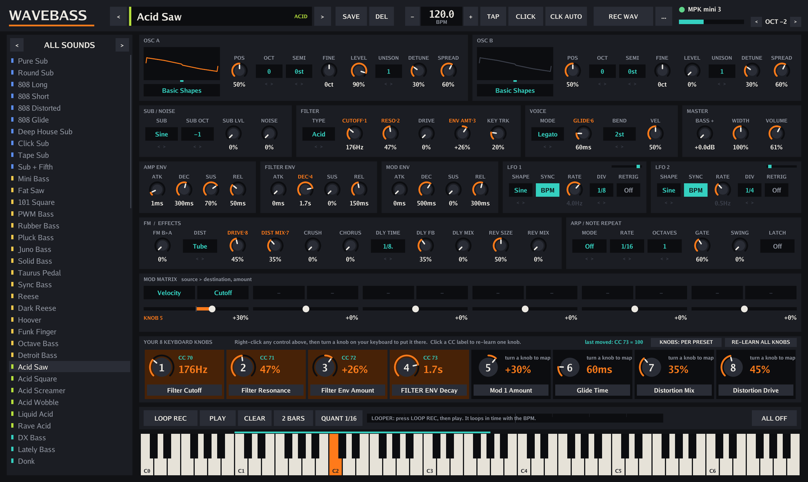

# WaveBass

A standalone wavetable bass synth for Windows that you play with a USB MIDI keyboard.
One `.exe`, no installer, no drivers, works offline.

**Download:** [`download/WaveBass.exe`](../../raw/main/download/WaveBass.exe), then double-click it.
(Windows SmartScreen may warn because the exe isn't code-signed: click **More info → Run anyway**.)



## Your keyboard's 8 knobs

- **They map themselves.** Turn each knob once, left to right: the first controller the app has
  not seen becomes knob 1, the next knob 2, and so on. The mapping is remembered.
- **Every preset sets the 8 knobs up for itself** (cutoff, resonance, wobble rate, wavetable
  position and so on). The strip at the bottom shows what each one does and its value.
- **Change what a knob does:** right-click any control on screen, then turn the hardware knob you
  want for it. Or click a knob's name in the strip and then click a control, or scroll over the name.
- **KNOBS: PER PRESET / LOCKED** keeps your own assignment for every preset.
- **Click a CC label** to re-learn one knob, or **RE-LEARN ALL KNOBS** to start over.
- Mod wheel, pitch bend, aftertouch, sustain pedal and program change (picks a preset) also work.

## Sound

- 2 wavetable oscillators (27 tables, 16 morphing frames each), up to 7 unison voices each,
  FM from B to A, sub oscillator, noise.
- Filter: LP 24, LP 12, band, high, notch and a squelchy Acid mode, with drive, envelope and key tracking.
- 3 envelopes, 2 LFOs (free or BPM-synced), 6-slot mod matrix.
- Distortion (6 types), bit crush, chorus, tempo-synced delay, reverb, bass boost, width, limiter.
- Poly (8 voices), mono and legato modes with glide.
- 94 presets: Sub, Classic, Acid, FM / Digital, Wobble, Growl, Neuro / DnB, Weird, Poly / Stab.
  **SAVE** stores your own in the User category.

## Playing and recording

| | |
|---|---|
| **BPM** | drag the number, scroll, `-` `+`, or **TAP**. Follows MIDI clock when it is sent (CLK AUTO). **CLICK** is a metronome. |
| **Arp / note repeat** | MODE: Repeat (retriggers held notes) or Up, Down, Up-Down, Random, Played. Rate 1/4 to 1/32T, octaves, gate, swing, latch. |
| **Looper** | LOOP REC, then play: recording starts on your first note and loops after 1, 2, 4 or 8 bars. Press again to overdub. Optional 1/16 quantise. |
| **REC WAV** | records the output to `Music\WaveBass`. `...` opens the folder. |
| **Computer keys** | `Z`–`/` and `Q`–`]` play notes, `←` `→` octave, `↑` `↓` preset, `Esc` all notes off. |
| **Controls** | drag knobs up/down (Shift = fine), scroll, double-click to reset. |

The MIDI keyboard is shifted down 2 octaves by default so a 25-key keyboard lands in bass range;
change it with the OCT arrows at the top right.

## Build

Needs Go 1.24+. Cross-compiles from any OS.

```
GOOS=windows GOARCH=amd64 go build -trimpath -ldflags "-s -w -H=windowsgui" -o download/WaveBass.exe .
go test ./synth/            # renders every preset, checks arp, looper, levels
go run ./tools/shot out.png # draws the window without a display
go run ./tools/levels       # re-balances preset loudness after editing presets
go run ./tools/winres       # regenerates the icon resource
```
